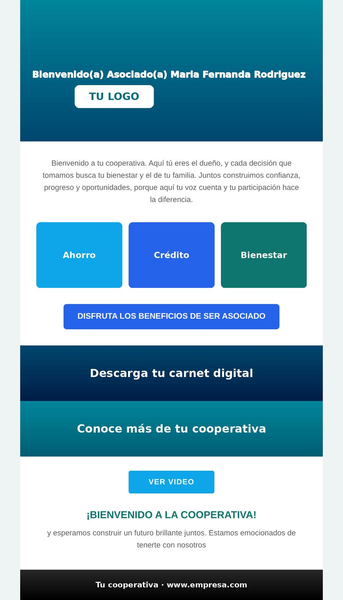
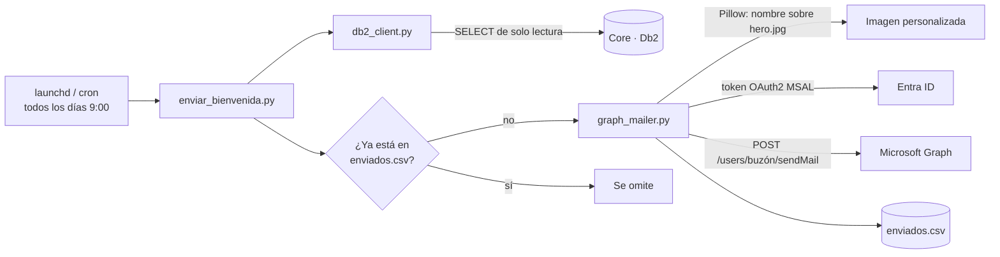

<div align="center">

# ✉️ Correo de bienvenida automático

**Detecta los clientes nuevos en el core financiero (IBM Db2) y les envía un correo de bienvenida personalizado por Microsoft Graph, una vez al día y sin duplicados.**

[](https://github.com/juandbueno9/correo-bienvenida-automatico/actions/workflows/ci.yml)


</div>

---

## 🎯 Problema

Los clientes nuevos no recibían ninguna comunicación de bienvenida, o se les enviaba a mano días después y sin personalizar.

## ✅ Solución

Un proceso diario que:

1. Consulta en el core los **ingresos del día anterior** que no tengan fecha de retiro, con un usuario de **solo lectura**.
2. Genera un correo HTML con el **nombre del cliente dibujado sobre la imagen de encabezado**, usando Pillow en el momento del envío.
3. Lo envía por **Microsoft Graph** con OAuth2 (*client credentials*), con las imágenes adjuntas *inline* (`cid:`).
4. Registra cada envío en `enviados.csv` para **no enviar dos veces** al mismo cliente.

<div align="center">

<br/><sub>Ejemplo con imágenes genéricas (las reales no se incluyen en el repo)</sub>
</div>

---

## 🏗️ Arquitectura



**Detalles técnicos**

- **Imagen dinámica:** el saludo "Bienvenido(a) … *Nombre*" se dibuja sobre `hero.jpg` justo encima del logo, con la posición calculada en fracciones del tamaño de la imagen (no se rompe si cambia la resolución). Si el nombre es largo, la letra **se reduce sola** para que quepa.
- **Fuentes con respaldo:** usa la tipografía de la marca si está instalada y, si no, una incluida en `assets/fonts/`.
- **Imágenes inline:** cada archivo de `assets/` se adjunta con su nombre como `Content-ID`, así la plantilla HTML solo usa `cid:nombre`.

---

## 🚀 Instalación

```bash
git clone https://github.com/juandbueno9/correo-bienvenida-automatico.git
cd correo-bienvenida-automatico
python3 -m venv venv && source venv/bin/activate
pip install -r requirements.txt
cp .env.example .env
```

Pon las imágenes del correo en `assets/` (ver [assets/LEEME.md](assets/LEEME.md)).

### Variables de entorno (`.env`)

| Variable | Descripción |
|---|---|
| `AZURE_TENANT_ID` / `AZURE_CLIENT_ID` / `AZURE_CLIENT_SECRET` | App de Entra ID con permiso de aplicación `Mail.Send` |
| `SENDER_EMAIL` | Buzón remitente |
| `DB2_HOST` / `DB2_PORT` / `DB2_DATABASE` / `DB2_USER` / `DB2_PASSWORD` | Conexión de solo lectura al core |

---

## 🖥️ Uso

| Comando | Qué hace |
|---|---|
| `python enviar_bienvenida.py --test correo@ejemplo.com` | Envía un correo de **prueba** con un nombre de ejemplo, sin tocar la base de datos |
| `python enviar_bienvenida.py --documento 123456` | Prueba real con un cliente puntual |
| `python enviar_bienvenida.py --listar` | Muestra quiénes recibirían el correo, **sin enviar** |
| `python enviar_bienvenida.py --fecha 2026-09-01` | Procesa una fecha de ingreso específica |
| `python enviar_bienvenida.py --dias-atras 7` | Recupera los ingresos de los últimos N días |
| `python enviar_bienvenida.py --inspeccionar` | Muestra las columnas reales de la vista |
| `python enviar_bienvenida.py` | Ejecución normal (ingresos de ayer) |

### Programación

**macOS (launchd):** ajusta las rutas en `com.empresa.bienvenida.plist` y luego:

```bash
cp com.empresa.bienvenida.plist ~/Library/LaunchAgents/
launchctl load ~/Library/LaunchAgents/com.empresa.bienvenida.plist
```

**Linux (cron):**

```cron
0 9 * * * cd /opt/correo-bienvenida && venv/bin/python enviar_bienvenida.py >> log.txt 2>&1
```

---

## 🔐 Seguridad
- Usuario de base de datos **de solo lectura**: la app nunca escribe en el core.
- `Mail.Send` como **permiso de aplicación**, que se puede limitar a un solo buzón con *Application Access Policy* de Exchange.
- `.env`, `enviados.csv` (datos personales) e imágenes de marca **fuera de git**.

## 📁 Estructura

```text
correo-bienvenida-automatico/
├── enviar_bienvenida.py      # CLI principal
├── db2_client.py             # Consultas de solo lectura al core
├── graph_mailer.py           # Token OAuth2, imagen dinámica y envío por Graph
├── plantilla_bienvenida.html # Plantilla de correo (tablas, compatible con Outlook)
├── com.empresa.bienvenida.plist
├── assets/                   # Imágenes (no versionadas)
└── docs/correo-ejemplo.jpg
```

---

**Autor:** [Juan Bueno](https://github.com/juandbueno9) · Licencia [MIT](LICENSE)
